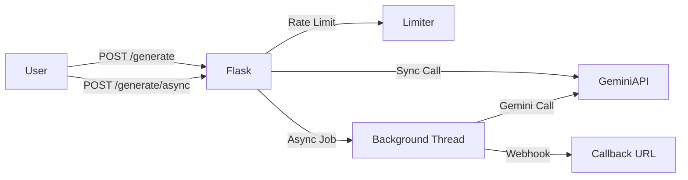

# API Wrapper

A Flask proxy that wraps Gemini API calls, adding rate limiting and asynchronous support via webhooks.

## Demo

https://maaz.multex.pk/api-wrapper

## Architecture



## Key Decisions and Trade-offs

- **Flask for Framework:** Chosen for its lightweight nature and minimal boilerplate, which is ideal for a focused API proxy. It is WSGI-compliant (essential for deployment environments like Passenger) and provides a mature ecosystem of extensions (like `flask-limiter`), allowing for rapid implementation of necessary middleware without the overhead of a full-stack framework.
- **Lazy Client Creation:** Gemini client is created lazily inside requests rather than at import time. This ensures safety across process forks (e.g., when deployed with Passenger), preventing inherited network socket issues.
- **`flask-limiter` for Rate Limiting:** Chosen for simplicity. Currently uses file-based storage (`/tmp/flask_limiter_storage`), which is fine for single-node deployments but limits horizontal scaling.
- **Threading for Async Jobs:** Used native Python threading for asynchronous requests to avoid introducing heavy dependencies like Redis and Celery. Acceptable for low-to-medium load prototypes, but not recommended for high-throughput production environments due to potential thread exhaustion.

## Results

- **Latency:** Dependent on Gemini API response times; minimal proxy overhead (<50ms).
- **Rate Limiting:** Successfully enforces 10 requests per minute limit per API key/IP.
- **Reliability:** Implements error handling for client, server, and rate limit errors with appropriate HTTP status codes.

## How to Run

### Requirements

- Python 3.9+
- `pip`

### Setup

1. Clone the repository.
2. Install dependencies:
   ```bash
   pip install -r requirements.txt
   ```
3. Set environment variables (create a `.env` file or export them):
   ```bash
   export GOOGLE_API_KEY="your_api_key_here"
   export DEMO_MODE="false" # Set to "true" to skip actual API calls
   ```
4. Run the application:
   ```bash
   python app.py
   # Or using a WSGI server like gunicorn
   gunicorn app:app
   ```

## Limitations and What's Next

- **Scalability:** File-based rate limiting (`/tmp`) will fail if the application is load-balanced across multiple instances. Switch to Redis for distributed rate limiting.
- **Background Tasks:** Using `threading` within Flask is risky. If the app restarts, in-flight jobs will be lost. Move to a persistent task queue like Celery with Redis/RabbitMQ.
- **Monitoring:** Lacks observability. Integrate Prometheus metrics and structured logging for better production monitoring.
